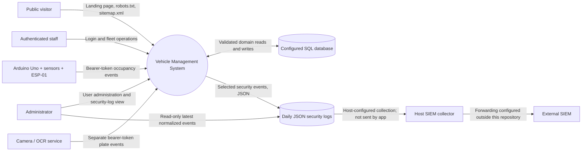
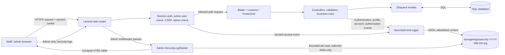

# Data Flow Diagrams

These diagrams describe the application flows implemented in the repository. They are documentation, not a
network deployment or VAPT assessment.

## DFD 0 — System context



## DFD 1 — Browser request and application processing



## DFD 1 — Parking sensor and OCR event processing

```mermaid
sequenceDiagram
    participant S as Parking sensor gateway
    participant T as Token middleware
    participant C as ParkingSensorController
    participant DB as SQL database
    participant O as OCR/camera service
    participant UI as Authenticated parking map

    S->>T: POST /api/parking/sensor (sensor bearer token, slot_code, occupied)
    T->>T: Check separate token, ten-slot configuration, and slot configuration
    T->>C: Validated request
    C->>DB: Transaction + lock slot/current record
    C->>DB: Update sensor state; create/close parking record
    C-->>S: JSON status

    O->>T: POST /api/parking/plate (OCR bearer token, slot_code, plate)
    T->>C: Validated request
    C->>DB: Transaction + lock slot/current record
    C->>DB: Save normalized plate; link eligible vehicle or leave unidentified
    C-->>O: JSON status

    UI->>DB: Read current slot and parking-record state
    DB-->>UI: Occupancy, detected plate, optional vehicle
```

## Trust boundaries and operational notes

- The browser-facing application should be deployed behind HTTPS. Laravel session/CSRF protection applies to
  web forms; route middleware protects authenticated and admin-only screens.
- Sensor and OCR calls use distinct bearer tokens. The sample ESP-01 firmware uses plain HTTP and is intended
  only for a trusted private LAN; do not expose it to the public internet.
- The host collector and SIEM are outside the Laravel application boundary. Configure file permissions,
  collection, transport security, alerting, and retention in the deployment environment.
- The security log page is read-only and does not turn the app into a SIEM. It displays at most 200 normalized
  recent events from a bounded log-file read.
- Public SEO routes do not access private fleet data. `robots.txt` and `noindex` are not authorization controls.
